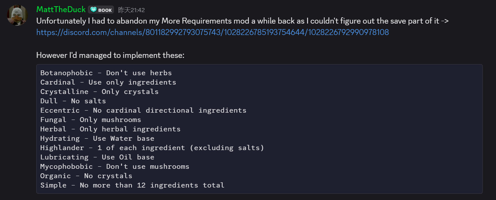

# Inspiration



# Potion Craft Extra Requirements / Customer Planner

This repository contains two standalone BepInEx plugins for _Potion Craft:
Alchemist Simulator_:

- `PotionCraftExtraRequirements` adds extensible extra customer requirements.
- `PotionCraftCustomerPlanner` adds an in-game regular customer planner window.

The plugins can be used independently. When both are installed, Customer Planner
discovers metadata exposed by Extra Requirements at runtime, so custom
requirements such as ingredient-category restrictions can display their fixed
semantic targets correctly.

## Mod launcher demo

A standalone Windows BepInEx mod launcher demo is available in
[`src/BepInExModLauncher`](src/BepInExModLauncher/README.md). It reads plugin and
assembly metadata directly from installed DLLs, resolves declared dependencies,
associates existing configurations by plugin GUID, and applies a startup selection
before launching the game. All mods use the same discovery logic.

The interface defaults to English. The Settings tab offers English, Simplified
Chinese, and an explicit option to follow the system language. Translated controls
resize or wrap to accommodate longer text.

Build the launcher project separately; it does not deploy into the game's plugin
folders. See its README for usage, limitations, and build instructions.

## Build

The projects expect the game install path to be provided by the `PotionCraftPath`
MSBuild property. The intended setup is to define it as an environment variable:

```powershell
$env:PotionCraftPath = "(your game install path)"
dotnet build -c Release
```

The build output is written directly to the BepInEx plugin folders:

```text
$(PotionCraftPath)\BepInEx\plugins\PotionCraftExtraRequirements\
$(PotionCraftPath)\BepInEx\plugins\PotionCraftCustomerPlanner\
```

You can also pass the property explicitly for a single build:

```powershell
dotnet build -c Release -p:PotionCraftPath="(your game install path)"
```

## Extra Requirements

Current built-in requirements:

| Requirement                                      | Unlock chapter |                         Price multiplier |
| ------------------------------------------------ | -------------: | ---------------------------------------: |
| No / only herbs                                  |              7 |                                  ×2 / ×3 |
| No / only mushrooms                              |              7 |                                  ×2 / ×3 |
| No / only crystals                               |              9 |                                  ×2 / ×3 |
| Highlander: at most 3 / 2 / 1 of each ingredient |              4 |                           ×1.5 / ×2 / ×3 |
| Simple Recipe: maximum total ingredient amount   |              9 | ×2 partial / ×3 full fulfillment |

Current conflict rules:

- Native Lowlander-2 (maximum two ingredients), Main Ingredient, and Need One
  Particular Ingredient cannot coexist as a triple. This patch leaves all
  three pairs compatible and preserves any rejection from the original game.
  It runs in Extra Requirements and applies regardless of generation order or
  mandatory/optional assignment, including Planner group validation when both
  plugins are installed.
- Broad ingredient-category restrictions conflict with each other, Highlander,
  No Salts, and incompatible particular/main ingredient requirements.
- Highlander requirements conflict with each other, broad ingredient-category
  restrictions, native main ingredient requirements, and native max ingredient
  type requirements.

Requirement enabled state, unlock chapter, generation weight, price multiplier,
and popularity reward are configurable in:

```text
BepInEx/config/cn.potioncraft.extra-requirements.cfg
```

### Simple Recipe: ingredient allowance and fulfillment tiers

All six broad ingredient-category restrictions (`NoHerbs`, `OnlyHerbs`,
`NoMushrooms`, `OnlyMushrooms`, `NoCrystals`, `OnlyCrystals`) default to
`SpawnWeight = 0.33`. This is a relative generation weight, not a 33% probability.
Existing configuration values are preserved; set these six entries to `0.33`
to apply the new weights to an existing installation.

The total-ingredient requirement preserves the updated distance formula:

```text
raw maximum = (0.2 + farthest requested effect distance / 8.0 + sum(allowances))
              × product(ingredient-limit multipliers)
displayed maximum = max(1, floor(raw maximum))
```

Distance is measured from the origin on the game's default potion-base map.
It is a heuristic; it does not search other bases for the shortest recipe.
Allowances add first, then all coefficients multiply; mandatory and optional
requirements contribute equally. The Simple Recipe requirement excludes itself.

| Requirement definition         |    Allowance |         Multiplier |
| ------------------------------ | -----------: | -----------------: |
| Additional Effects             |           +4 |                 ×1 |
| Main Ingredient                |         +0.5 |               ×1.4 |
| Need One Particular Ingredient |           +1 |                 ×1 |
| No Particular Ingredient       |           +0 |                 ×1 |
| No Salts (native)              |           +0 |              ×1.35 |
| Highlander-1 / 2 / 3           | +3 / +2 / +1 |                 ×1 |
| Lowlander-1 / 2 / 3            |           +0 | ×1.6 / ×1.3 / ×1.1 |
| Only Water / No Oil / No Wine  |           +0 |         ×1.25 each |
| Other requirements             |           +0 |                 ×1 |

The base restriction is identified from the generated target (or fixed wrapper
target), not the language-dependent displayed name. Only Water receives ×1.25;
Only Oil, Only Wine and No Water do not. Native compatibility still determines
which restrictions can coexist.

A potion must use at least one ingredient and meet the displayed maximum to
partially fulfill Simple Recipe. Its partial-fulfillment multiplier is the configured value
(default ×2). If its actual ingredient count is **at most 60% of the unrounded
raw maximum**, it fully fulfills the requirement and uses `EnhancedCostMultiplier` (default **×3**), replacing
its partial-fulfillment multiplier rather than multiplying it again. Other requirements'
price multipliers continue to stack normally. Simple Recipe awards +1 popularity
for partial fulfillment and +2 for the full-fulfillment tier by default; +2 replaces +1,
rather than adding to it. An unmet requirement awards no popularity.
Highlander-1 / 2 / 3 already award +2 / +1 / +1 popularity by default.

The two tiers are called **partial fulfillment** and **full fulfillment**. For compatibility, the existing config keys retain their names: `CostMultiplier` / `PopularityBonus` configure partial fulfillment, and `EnhancedCostMultiplier` / `EnhancedPopularityBonus` configure full fulfillment.

Both reward tiers are configurable in `BepInEx/config/cn.potioncraft.extra-requirements.cfg`:

```ini
[Requirement: SimpleRecipe]
CostMultiplier = 2
EnhancedCostMultiplier = 3
PopularityBonus = 1
EnhancedPopularityBonus = 2
```

The new full-fulfillment entry is added on plugin startup; existing partial-fulfillment
settings are retained. If an existing SimpleRecipe config still has
`PopularityBonus = 2`, change it to `1` to adopt the new partial-fulfillment default.
The 60% threshold is unchanged and is shared by price and popularity rewards.

For example, raw maximum 6.99 displays as 6; four ingredients qualify for ×3
because `4 <= 6.99 × 0.6`, while five or six receive the partial-fulfillment multiplier.
The minimum-one display clamp does not increase the full-fulfillment threshold.
The raw value is retained in the generated requirement's `stringValue1` using
an invariant-culture marker, so Planner copies and snapshots preserve it.
An older generated requirement with no raw value receives no inferred bonus.

When the potion and all requirements are satisfied but Simple Recipe has not
reached the full-fulfillment tier, the customer gives a partial-success
line showing the exact ingredient threshold in the customer's own words, without
mentioning multipliers. For raw maximum 6.99, it can say “This will do. But if you
could make it with no more than 4 ingredients, I'd gladly pay a little extra.”
The displayed threshold and reward calculation share the
same rule: `min(displayed maximum, floor(raw maximum × 0.6))`.
The threshold is formatted at display time so recalculating the requirement
does not leave a stale number in its reaction. If no positive ingredient count
can reach the full-fulfillment tier, or the raw value is unavailable, no bonus hint is shown.
This does not turn a valid potion into a failure. Existing
failure, wrong-effect, and closeness-exchange responses keep priority; native
additional-effect partial feedback is preserved. Generic tier praise (including
“Excellent!”) is replaced by the partial-success line, as with native additional
effects. Both English and Chinese are supplied.

### Extending requirement metadata

Custom requirements declare their contribution on `RequirementDefinition`:

```csharp
var definition = new RequirementDefinition(/* existing constructor arguments */)
{
    IngredientLimitModifier = generated => new IngredientLimitModifier(
        allowance: 1f, multiplier: 1.25f),
    // Optional: called only for a completed requirement, with its generated data.
    DynamicCostMultiplier = (potion, quest, generated, ordinaryMultiplier) =>
        ordinaryMultiplier
};
RequirementCatalog.Register(definition);
```

Omitting the modifier means +0 / ×1. Highlander's allowance is declared where
its definition is registered; the formula no longer parses requirement names.
Highlander-3 → Highlander-2 → Highlander-1 increases difficulty: ingredient
allowance +1 → +2 → +3 and default price multiplier ×1.5 → ×2 → ×3.
Native definitions are attached in `NativeRequirementDefinitions` using
`IngredientLimitRegistry.RegisterNative<T>(...)`. Matching uses the exact
native type, so a custom requirement using the No Salts carrier does not inherit
the native ×1.35 coefficient. Registered custom metadata takes precedence.

The source files separate these responsibilities:

- `IngredientLimitMetadata.cs`: allowance/coefficient values, aggregation and native/custom registry.
- `NativeRequirementDefinitions.cs`: native requirement metadata mappings.
- `SimpleRecipeRequirementLogic.cs`: budget formula, reward thresholds, encoding, text and reaction patches.
- `CurrentCustomerBudget.cs`: current-customer context and its game lifecycle patches.
- `DynamicRequirementRewardPatches.cs`: price/popularity fallback for non-current generated groups.

Final budget calculation now runs after `Quest.ApplyPartTo` assigns the complete
group, including for queued customers. The old Simple Recipe postfix on
`Quest.GetGeneratedQuestRequirements` was removed to avoid duplicate finalization.
Initial per-requirement generation still supplies values for planner validation.
The temporary localization diagnostic file writer and unused integer-budget helper
were removed. Effect distance is read during budget updates, without retaining a
separate permanent quest cache. Public metadata types and configuration keys are unchanged.

`RequirementTexts.PartialReactions` supplies optional partial-success lines for
both mandatory and optional text pools. For the current customer, the native
`GetCostMultiplier(potion, quest)` and `GetPopularityToAdd(potion, quest)` interfaces
evaluate the applicable tier using the refreshed customer context. Aggregation
keeps that result. The dynamic aggregation hooks remain as a fallback for other
generated groups, using that group's own parameters rather than the active customer's.

Budget updates are driven by the game's lifecycle. Before applying a quest to
the current customer, the previous budget is invalidated; after the quest's
complete requirement group is assigned, the budget and Simple Recipe's generated
values are refreshed. Text, satisfaction, price and popularity then share the
same limit. Native customer switching, reset and save loading also update or
clear the context. `CurrentCustomerBudget.RawMaximum` is null when the active
group contains no Simple Recipe requirement.

Planner applies edits and preview restoration through native `Quest.ApplyPartTo`.
For that call only, its generation hook supplies the already prepared mandatory
and optional groups, including explicitly empty groups. Generation hooks still
run, but native/global random selection does not reroll the edited requirements
or advance the random state. The override is scoped to the exact quest/customer
and restored on exit, including nested calls and exceptions. Dialogue and trade
refresh after the native application completes.

Preview edits the real interactive customer; restoration uses the same native
lifecycle with the saved group. Planner has no plugin lookup, reflection call or
direct API dependency on Extra Requirements. Both mods remain independently
usable. This reuses quest application rather than replaying `OnCurrentNpcChanged`,
whose native trade listener resets trader inventory, gold and haggle state.
No Quest cloning or per-frame budget recalculation is needed.

Metadata, reward boundaries, current-customer refresh and lifecycle hook checks
can be run outside Unity with .NET Framework 4.8 and the game's `0Harmony.dll`
(resolved through `PotionCraftPath`). Game object shapes are stubbed; lifecycle
patch installation uses real Harmony:

```powershell
dotnet run --project tests/IngredientLimitMetadata.Tests/IngredientLimitMetadata.Tests.csproj
```

## Localization

- Default language: English.
- Currently supported translation: Simplified Chinese (`zh`).
- Other locales fall back to English.

Mod text is exposed through the game localization path. Requirement rendering
still uses the native `GeneratedQuestRequirement` UI, so warning marks, plus
icons, checkmarks, colors, fonts, and rich-text formatting come from the game’s
own assets.

Each requirement provides a small set of mandatory text, optional preference
text, and failure reaction text. The game’s native requirement text pool chooses
the final line; the mod UI does not assemble requirement sentences manually.

## Customer Planner

Customer Planner is split into its own project:

```text
src/PotionCraftCustomerPlanner/PotionCraftCustomerPlanner.csproj
```

Integration notes for other requirement mods are in
[Customer Planner README](src/PotionCraftCustomerPlanner/README.md).

Default toggle key: `F2`.

Runtime settings are stored in:

```text
BepInEx/config/cn.potioncraft.customer-planner.cfg
```

Useful window options include:

- `ToggleShortcut`
- `UIFontSize`
- `PickerFontSize`
- `PickerIconSize`
- `InlineIconSize`
- `InlineIconSpacing`
- `BlockGameInputWhenOpen`
- `NoneButtonColor`
- `MustButtonColor`
- `CanButtonColor`
- `CustomerSelectedColor`

Color values use `#RRGGBB` or `#RRGGBBAA`.

### Planner behavior

The planner modifies the active current customer only. It no longer patches the
not-yet-spawned queue, does not mutate already-spawned waiting NPCs, and does
not write or repair quest/template cooldown state.

When a schedule is added:

- If the current customer can be modified, the planner applies the selected
  customer, quest, and requirement set immediately.
- If there is no current customer, or the current customer cannot be modified,
  the schedule remains pending.
- Each time a new NPC becomes the current customer, the planner tries the
  pending schedule again.

Strict mode limits current-customer rebuilds to normal faction/class customers.
Non-strict mode skips most natural-spawn checks but still avoids merchants and
customers already reserved by another pending schedule.

### Search and selection

The planner supports:

- Manual search. Opening the window does not scan the customer pool repeatedly.
- Exact internal-name search for:
  - `NpcTemplate.name`
  - `Faction.name`
  - `FactionClass.name`
- Text search over customer/faction/class/template identity.
- Quest effect filters:
  - `Needs` effects must all be present.
  - `Excludes` effects remove quests containing any listed effect.
  - Adding an effect to one side automatically removes the same effect from the
    opposite side.
- Chapter and karma preview overrides in non-strict mode.
- A selected target quest for the planned customer.

Customer list rows show compact public information such as customer identity,
gender, karma range, unlock chapter, and matching quest count. Internal names
and full effect summaries remain available in hover tooltips.

### Requirement localization

For the current customer's tiered requirements, direct `GetCostMultiplier` calls
return the actual multiplier: Simple Recipe defaults to ×2 for partial fulfillment,
×3 for full fulfillment and ×1 when unmet. `GetPopularityToAdd` returns +1, +2 or
0 respectively. Without a matching current-customer context, direct price reads
retain the configured full-fulfillment fallback; aggregate calculations can still
evaluate a supplied generated group. Existing configuration keys are unchanged.

Custom requirement localization is installed before pool injection. Generated
text and reaction fields retain localization keys; Simple Recipe substitutes
its current ingredient cap and full-fulfillment threshold only when displayed. Its internal
ID remains `PCER_SimpleRecipe`.

If an older build shows `#quest_condition_...`, check Unity's `Player.log` for
`Undefined target method` in `NativeIngredientTripleConflictPatch::Postfix`.
That startup failure prevented localization patches from being installed. This
build fixes the Harmony helper-name collision. Restart the game with the rebuilt
DLL and regenerate affected customers when checking the fix.

The native triple-conflict regression test uses the game's `0Harmony.dll` and
.NET Framework 4.8 to verify actual patch installation as well as all six
generation orders:

```powershell
dotnet run --project tests/NativeIngredientTripleConflict.Tests -c Release
```

### Requirement planning

Planner's random-rule weight inputs edit actual generation weights. Unedited
entries and Reset use each requirement's current `spawnChance`, including mod
configuration (for example, `0.33` for ingredient-category restrictions). Opening
the window does not create overrides. An edited value replaces the base weight;
`0` excludes the requirement from random selection. These inputs are not multipliers.

The planner can assign mandatory (`Must`) and optional (`Can`) extra
requirements to the planned customer.

Target handling follows requirement metadata:

- Requirements with no target show no target row.
- Native wrappers that already contain an `Ingredient` or `PotionBase` show a
  read-only fixed target.
- Native target-capable requirements without a fixed wrapper target can be
  edited with `Ingredient.name` or `PotionBase.name`; the picker button opens a
  bounded dropdown.
- Extra Requirements ingredient-category restrictions expose fixed semantic
  targets such as herbs, mushrooms, and crystals.

The requirement table is grouped by native type and discoverable external tags.
Unknown external requirements are grouped under `Other / external`.

Before scheduling, the planner validates the selected requirement group against
the selected customer and target quest. Combinations blocked by native or
external conflict rules are rejected in the planner UI.

If the planner modifies the active customer while a potion is already on the
scales, it asks the game UI to refresh request text, potion suitability, trade
buttons, and deal value immediately.
